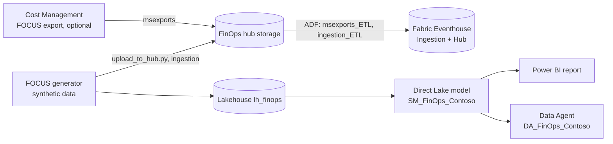

# FinOps on Azure and Microsoft Fabric: FOCUS, FinOps hub and a Data Agent

[Polska wersja](README.md)

Demo material for a 45-minute technical session on FinOps with Microsoft Fabric. It covers the FOCUS cost data specification, a FinOps hub (FinOps toolkit v15) running on Fabric Real-Time Intelligence, a Direct Lake semantic model with a Power BI report, and a Fabric Data Agent that answers cost questions in Polish. The full session script, KQL queries and expected results are in [README.md](README.md).

> **Disclaimer.** Contoso Polska is a fictional company. All cost data is synthetic, generated by `metodyka/gen_focus.py`; only the unit list prices come from the public Azure Retail Prices API (`dane/retail_prices_raw.json`). This is a personal demo project, not an official Microsoft sample, and it is provided as is. You can optionally connect your own FOCUS export from Cost Management; the repository contains no real billing data.

## Architecture

| Folder | Content |
|---|---|
| `dane/` | Synthetic FOCUS data (parquet, CSV), dimension tables, lakehouse-ready tables, Azure Retail Prices snapshot |
| `metodyka/` | Python and PowerShell scripts: data generator, deployment to Fabric via REST, hub upload, deck builder |
| `model/` | Semantic model (TMDL) and report (PBIR-Legacy) generated offline, with `<PLACEHOLDER>` IDs |
| `deck/` | Opening slide deck generated by `metodyka/build_deck.py` (Polish) |

## Requirements

- Azure subscription with permission to deploy the FinOps hub template, and a Microsoft Fabric capacity
- A Fabric workspace with an Eventhouse (databases `Ingestion` and `Hub`) and a lakehouse named `lh_finops`
- Azure CLI signed in with `az login`
- Python 3.12+ with `pandas`, `pyarrow`, `requests`, `python-pptx` (deck only)
- PowerShell 7 for `metodyka/download_ftk.ps1`

## How to reproduce

1. Download the FinOps toolkit v15 assets: `pwsh metodyka/download_ftk.ps1` (saved to `metodyka/ftk-v15/`, git-ignored).
2. Create the Eventhouse and lakehouse in Fabric, then run `finops-hub-fabric-setup-Ingestion.kql` and `finops-hub-fabric-setup-Hub.kql` in the Eventhouse as described in the FinOps hubs documentation.
3. Deploy the hub, for example `az deployment group create -g <resource-group> --template-file metodyka/ftk-v15/hub/main.bicep -p hubName=<name> fabricQueryUri=<eventhouse-query-uri>`. See the toolkit documentation for other parameters.
4. Set environment variables:

   | Variable | Purpose |
   |---|---|
   | `FABRIC_WORKSPACE_ID` | Target workspace |
   | `FABRIC_WORKSPACE_NAME` | Workspace name used in report connection strings |
   | `FABRIC_LAKEHOUSE_ID` | The `lh_finops` lakehouse |
   | `EVENTHOUSE_QUERY_URI` | Eventhouse query URI |
   | `FINOPS_HUB_STORAGE_ACCOUNT` | Hub storage account name (only for `upload_to_hub.py`) |
   | `AZURE_SUBSCRIPTION_ID` | Optional, subscription context for `az` tokens |

5. Run from `metodyka/`: `upload_to_hub.py`, `prep_lakehouse.py`, `deploy_model.py`, `deploy_report.py`, `deploy_agent.py --publish`. Optionally `deploy_hub_dashboard.py`, `deploy_hub_reports.py` and `refresh_hub_reports.py` for the toolkit's own dashboard and KQL reports.
6. `gen_focus.py` regenerates the synthetic data (already committed); `build_deck.py` rebuilds the deck; `deploy_model.py --offline` and `deploy_report.py --offline` regenerate the files in `model/` without deploying.

`upload_to_hub.py` has not been run in its current form; check the hub's Data Factory runs after using it.

## FinOps toolkit license

The [FinOps toolkit](https://github.com/microsoft/finops-toolkit) is a Microsoft project released under the [MIT License](https://github.com/microsoft/finops-toolkit/blob/main/LICENSE). This repository does not redistribute it. `download_ftk.ps1` fetches the unmodified v15 release assets and the toolkit's LICENSE file from GitHub.

## License

MIT, see `LICENSE`.
