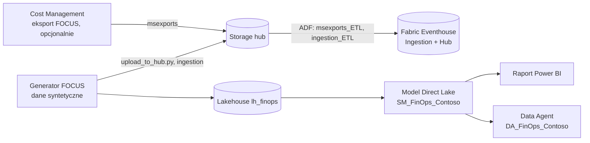

# FinOps w Azure i Microsoft Fabric: FOCUS, FinOps hub i Data Agent

[English version](README.en.md)

Scenariusz 45-minutowej sesji technicznej z demo. Odbiorcy to architekci, inżynierowie i osoby, które zajmują się FinOps na co dzień. Wszystkie dane firmy „Contoso Polska” są syntetyczne i powstają w skrypcie `metodyka\gen_focus.py`. Kto chce pokazać, że ten sam pipeline przyjmuje prawdziwe dane, może podłączyć do huba własny eksport FOCUS z Cost Management (krok 1, część opcjonalna).

Najważniejsze rzeczy przed sesją:

1. Demo potrzebuje pojemności Fabric, workspace, Eventhouse z bazami `Ingestion` i `Hub` oraz FinOps hub v15 wdrożonego w trybie Fabric. Identyfikatory podajesz w zmiennych środowiskowych (sekcja 6). Pojemność trzeba wznowić najpóźniej godzinę przed sesją, bo po wznowieniu Eventhouse i model Direct Lake potrzebują chwili na rozgrzanie.
2. Zapytania KQL w demo filtrują po `x_SourceName == 'Synthetic'`. Przy samych danych syntetycznych filtr niczego nie zmienia, ale po podłączeniu własnego eksportu (zwykle w innej walucie) chroni sumy przed mieszaniem walut.
3. Data Agent `DA_FinOps_Contoso` trzeba opublikować (`deploy_agent.py --publish` albo w portalu) i przed sesją przejść pytania z kroku 4.

## Spis treści

1. Agenda i podział czasu
2. Przygotowanie przed sesją
3. Demo krok po kroku
4. Historia zaszyta w danych syntetycznych
5. Materiały publiczne
6. Konfiguracja i elementy wdrożenia
7. Odtworzenie i kod
8. Źródła
9. Luki i pytania

## 1. Agenda i podział czasu

| Czas | Blok | Co pokazuję | Materiał |
|---|---|---|---|
| 0:00 do 0:05 | Po co FinOps i gdzie jest Fabric | Fazy Inform, Optimize, Operate. Fabric jako koszt stały (pojemność) i zmienny (OneLake, PAYG ponad rezerwację) | deck z `deck\` |
| 0:05 do 0:10 | FOCUS | Czym jest specyfikacja, które kolumny są kluczowe (BilledCost, EffectiveCost, ListCost, ChargeCategory, CommitmentDiscount*), eksport FOCUS w Cost Management | What is FOCUS? (Learn), focus.finops.org |
| 0:10 do 0:14 | Architektura demo | Eksport FOCUS, FinOps hub v15, Fabric Eventhouse, Lakehouse, model Direct Lake, raport, Data Agent | diagram poniżej |
| 0:14 do 0:22 | Demo 1, Hub i KQL | Tagi, anomalie, rezerwacje, ESR, opcjonalnie własny eksport FOCUS | krok 1 |
| 0:22 do 0:30 | Demo 2, raport Power BI | Budżety spółek, showback, alokacja i tagowanie, optymalizacja | krok 2 i 3 |
| 0:30 do 0:36 | Demo 3, Data Agent | Pytania w języku naturalnym, wgląd w wygenerowany DAX | krok 4 |
| 0:36 do 0:41 | FinOps dla samego Fabric | Capacity Metrics, Chargeback app, surge protection, pauza i rezerwacja pojemności | krok 5 |
| 0:41 do 0:45 | Pytania | | |

Diagram do slajdu architektury:



## 2. Przygotowanie przed sesją

1. Wznów pojemność Fabric w portalu Azure albo poleceniem `az fabric capacity resume -g <grupa zasobów> --capacity-name <nazwa pojemności>`.
2. Otwórz w osobnych kartach przeglądarki:
   1. Workspace demo w portalu Fabric.
   2. Bazę KQL `Hub` w Eventhouse (kwerendy z kroku 1 wklejone do zestawu zapytań).
   3. Raport „FinOps Contoso Polska (dane syntetyczne)”.
   4. Data Agent `DA_FinOps_Contoso` w workspace.
   5. Jeśli pokazujesz własny eksport: portal Azure z eksportem FOCUS (Cost Management, Exports).
3. Uruchom raport raz, żeby model Direct Lake załadował kolumny do pamięci. Zadaj agentowi jedno pytanie na rozgrzewkę.
4. Opcjonalnie zainstaluj wcześniej Capacity Metrics app (krok 5). Instalacja i pierwsze odświeżenie trwają, więc nie rób tego na żywo.
5. Po sesji wstrzymaj pojemność. Przy wstrzymanej pojemności Eventhouse nie przyjmuje danych, więc eksporty z dni pauzy wpadną do Hub dopiero po wznowieniu i ponownym uruchomieniu pipeline'ów Data Factory huba. Przebieg, który padł z błędem CapacityNotActive, można ponowić:

```powershell
az datafactory pipeline create-run -g <grupa zasobów> --factory-name <nazwa Data Factory huba> --name ingestion_ExecuteETL --reference-pipeline-run-id <runId nieudanego przebiegu> --is-recovery true
```

Deck na otwarcie sesji (8 slajdów, z notatkami prelegenta) generuje `metodyka\build_deck.py` do pliku `deck\FinOps_Fabric_otwarcie.pptx`.

## 3. Demo krok po kroku

### Krok 1. FinOps hub w Fabric Eventhouse (KQL)

Komentarz otwierający: FinOps toolkit v15 może zapisywać dane huba bezpośrednio do Fabric Real-Time Intelligence. Baza `Ingestion` trzyma surowe i przetworzone tabele, baza `Hub` udostępnia funkcje w wersjach schematu (`Costs()`, `Costs_v1_2()` i inne). Pracujemy na funkcjach, nie na tabelach.

Zapytanie 1.1. Skąd pochodzą dane:

```kusto
Costs()
| summarize Wiersze = count(), Koszt = round(sum(EffectiveCost), 2),
    Od = min(ChargePeriodStart), Do = max(ChargePeriodStart), Waluta = take_any(BillingCurrency)
    by x_SourceName, BillingAccountName
```

Dla danych syntetycznych wynik to źródło `Synthetic` (Contoso Polska, 10 814 wierszy, 211 969,74 EUR, od 1.05 do 14.11).

Część opcjonalna: własny eksport FOCUS. Jeśli w Cost Management skonfigurujesz eksport FOCUS do kontenera `msexports` huba, to po przetworzeniu przez pipeline'y huba w tym samym zapytaniu pojawi się drugie źródło (`x_SourceName` z wartością nadaną przez hub dla Cost Management). Wyniki zależą od Twojej subskrypcji, dlatego repozytorium ich nie podaje. Proste zapytanie do pokazania własnych zasobów:

```kusto
Costs()
| where x_SourceName != 'Synthetic'
| summarize Koszt = round(sum(EffectiveCost), 2) by ServiceName, x_ResourceGroupName, BillingCurrency
| top 10 by Koszt
```

Konfigurację eksportu opisuje dokumentacja FinOps hubs (sekcja 8).

Zapytanie 1.2. Surowe tagi kontra rzeczywista alokacja:

```kusto
Costs()
| where x_SourceName == 'Synthetic'
| extend CostCenter = tostring(Tags['CostCenter'])
| summarize Koszt = round(sum(EffectiveCost), 0) by CostCenter
| order by Koszt desc
```

Wynik: CC-300 111 701, CC-100 49 040, CC-900 22 213, pusty tag 19 860, CC-200 9 156 EUR. Klucz CC-400 (AI Lab) w ogóle nie występuje, bo zasoby AI Lab nie mają tagu. Do tego zasoby z kluczem `costcenter` pisanym małymi literami trafiają do pustego tagu. W modelu semantycznym poprawiam to regułą „tag, a w braku tagu subskrypcja”, i to jest pomost do kroku 3.

Zapytanie 1.3. Wykrywanie anomalii wbudowanymi funkcjami KQL:

```kusto
Costs()
| where x_SourceName == 'Synthetic'
| make-series Koszt = sum(EffectiveCost) default = 0 on ChargePeriodStart
    from datetime(2026-05-01) to datetime(2026-11-15) step 1d by ServiceCategory
| extend (Anomalie, Wynik, Bazowa) = series_decompose_anomalies(Koszt, 2.5)
| mv-expand ChargePeriodStart to typeof(datetime), Koszt to typeof(double), Anomalie to typeof(int)
| where Anomalie != 0
| summarize Dni = count(), Pierwszy = min(ChargePeriodStart)
    by ServiceCategory, Kierunek = iff(Anomalie > 0, 'wzrost', 'spadek')
| order by Pierwszy asc
```

Wynik: wzrost w Management and Governance od 13.10 (12 dni, włączone logowanie debug do Log Analytics) i spadek w Analytics od 2.11 (wyłączenie Databricks po migracji do Fabric). Skoku GPU z września ten próg nie wykrył. To dobry punkt do rozmowy o strojeniu progu czułości i o tym, że anomalia nie musi oznaczać problemu.

Zapytanie 1.4. Wykorzystanie rezerwacji:

```kusto
Costs()
| where x_SourceName == 'Synthetic' and isnotempty(CommitmentDiscountName)
| summarize Wykorzystane = round(sumif(EffectiveCost, CommitmentDiscountStatus == 'Used'), 0),
            Niewykorzystane = round(sumif(EffectiveCost, CommitmentDiscountStatus == 'Unused'), 0)
    by CommitmentDiscountName
| extend Wykorzystanie = round(100.0 * Wykorzystane / (Wykorzystane + Niewykorzystane), 1)
| order by Wykorzystanie asc
```

Wynik: RI-E8sv5-tms-1Y 85% (719 EUR niewykorzystane), RI-D4sv5-eshop-1Y i RI-Fabric-64CU-1Y po 100%.

Zapytanie 1.5. Effective Savings Rate miesiąc po miesiącu:

```kusto
Costs()
| where x_SourceName == 'Synthetic'
| summarize ListCost = sum(ListCost), EffectiveCost = sum(EffectiveCost)
    by Miesiac = startofmonth(ChargePeriodStart)
| extend ESR = round(100.0 * (ListCost - EffectiveCost) / ListCost, 1)
| project Miesiac, ESR
| order by Miesiac asc
```

Wynik: od maja do sierpnia od 7,7 do 8,1%, we wrześniu 26,9%, w październiku 25,5%, w listopadzie 41,3%. Skok we wrześniu to zakup rezerwacji Fabric 64 CU. Wartość listopadowa jest zawyżona, bo w danych jest tylko pół miesiąca, a dni z przekroczeniem pojemności (płatne PAYG) przypadły na październik. Warto to powiedzieć wprost, zanim ktoś z sali zapyta.

### Krok 1b. Gotowe raporty Microsoftu z FinOps toolkit

Zanim pokażesz własny raport, warto pokazać to, co Microsoft daje razem z hubem, bez pisania ani jednego zapytania. Skrypty z `metodyka\` wdrażają te elementy do workspace demo, a czytają one prosto z bazy `Hub`:

1. Dashboard Real-Time Intelligence „FinOps hub dashboard” (z `finops-hub-dashboard.json`, v15, skrypt `deploy_hub_dashboard.py`). Strony Summary, Anomaly management, Data ingestion, Rate optimization, Licensing + SaaS, Budgeting, Invoicing + chargeback. Parametr waluty rozdziela źródła, jeśli oprócz danych syntetycznych w EUR podłączysz eksport w innej walucie.
2. Raporty Power BI w wersji KQL (skrypt `deploy_hub_reports.py`): „FinOps hub Cost summary”, „FinOps hub Rate optimization”, „FinOps hub Invoicing”. Model w trybie Import, filtr Currency ustaw na EUR. Strona Total savings w Rate optimization powinna pokazać te same liczby co kwerenda ESR wyżej (17,41% za cały okres, 26,90% we wrześniu), co dobrze spina KQL z raportem.

Pomijam raporty Governance i Workload optimization, bo potrzebują Azure Resource Graph, oraz Data ingestion, którego usługa Power BI nie odświeża (dynamiczne źródło, błąd DynamicDataSourcesIsNotSupportedForRefresh). Stan ingestii widać na stronie Data ingestion w dashboardzie.

Poświadczenia do Eventhouse ustawia `metodyka\refresh_hub_reports.py` tokenem konta az, ważnym około godziny. Wystarcza to na jedno odświeżenie. Jeśli raporty mają się odświeżać same, trzeba w ustawieniach każdego modelu zalogować się w sekcji Data source credentials.

### Krok 2. Raport, strona „Przeglad i budzet”

Karty na górze: koszt efektywny 211 970 EUR, budżet 266 000 EUR, wykonanie 79,7%, ESR 17,4%, wykorzystanie rezerwacji 96,5%.

Wykonanie budżetu za cały okres:

| Spółka | Koszt (EUR) | Budżet (EUR) | Wykonanie |
|---|---|---|---|
| Data Platform | 111 701 | 136 500 | 82% |
| Retail | 49 372 | 63 000 | 78% |
| Shared | 22 213 | 24 500 | 91% |
| AI Lab | 14 434 | 24 500 | 59% |
| Logistics | 13 531 | 17 500 | 77% |

Pułapka do pokazania: za cały okres AI Lab wygląda na najbardziej oszczędną spółkę (59%). Po wybraniu września we fragmentatorze ta sama spółka ma 124,6% (4 362 EUR przy budżecie 3 500 EUR) przez maszynę A100 do fine-tuningu. Budżet ocenia się w miesiącu, nie w sumie.

Tabela showback na dole pokazuje koszt spółki w podziale na miesiące. Na rzutniku ta tabela przewija się w poziomie, więc lepiej ją powiększyć trybem „Focus mode”.

### Krok 3. Raport, strony „Alokacja i tagowanie” oraz „Optymalizacja i trendy”

Strona „Alokacja i tagowanie”:

1. Wykres pierścieniowy: 9,4% kosztu nie ma poprawnego tagu CostCenter. Brak CostCenter to 14 766 EUR, brak jakichkolwiek tagów 3 230 EUR, błędna wielkość liter w nazwie klucza 1 864 EUR.
2. Kolumny „Zrodlo alokacji” pokazują, ile kosztu przypisano z tagu, ile awaryjnie z subskrypcji, a ile nie dało się przypisać wcale.
3. Tabela zasobów. Najciekawsze pozycje to `aoai-ailab` (11 991 EUR, brak CostCenter), `vm-a100-finetune` (2 443 EUR), trzy osierocone dyski `disk-tms-old-01..03` bez tagów (po 837 EUR) oraz `vm-tms-dev-03` i `vm-tms-dev-04` z kluczem `costcenter` zapisanym małymi literami. Tu pada pytanie do sali: czy egzekwować tagi przez Azure Policy (deny lub modify), czy alokować po subskrypcji.

Strona „Optymalizacja i trendy”:

1. Linia dzienna po ServiceCategory. Widać spadek Analytics od września (rezerwacja Fabric), skok Compute we wrześniu (GPU), skok Management and Governance w październiku i stały wzrost AI.
2. Tabela rezerwacji z wykorzystaniem. RI-E8sv5-tms-1Y spadła do 85% po wyłączeniu `vm-tms-sql-03` 17.08. Dobre miejsce na wątek o wymianie rezerwacji i zmianie zasad wymiany (sprawdź aktualne zasady w dokumentacji Azure Reservations).
3. Tabela usług i mierników. `vm-tms-sql-01` płaci za licencję Windows, bo nie ma włączonego Azure Hybrid Benefit.

Zapytanie DAX do pokazania w DAX query view:

```dax
EVALUATE
CALCULATETABLE(
    SUMMARIZECOLUMNS(
        Spolki[Spolka],
        "Koszt", [Koszt efektywny],
        "Budzet", [Budzet],
        "Wykonanie", [Wykonanie budzetu]
    ),
    Kalendarz[Rok] = 2026,
    Kalendarz[MiesiacNr] = 9
)
```

### Krok 4. Data Agent

Agent `DA_FinOps_Contoso` korzysta z modelu `SM_FinOps_Contoso`. Instrukcje agenta (po polsku) mówią mu, że dane są syntetyczne, że domyślną miarą jest koszt efektywny, jak czytać status tagowania i że listopad jest niepełny.

Pytania, które autor sprawdził przez API na pierwotnym wdrożeniu (odpowiedzi zgodne z DAX):

1. „Która spółka miała najwyższe wykonanie budżetu we wrześniu 2026?” Agent odpowiedział, że Contoso AI Lab z wykonaniem 124,6% i przekroczeniem o 862 EUR.
2. „Które zasoby nie mają poprawnego tagu CostCenter i ile kosztowały?” Agent zwrócił listę od `aoai-ailab` (11 991 EUR) do `vm-eshop-dev-03` (332 EUR). Jedna pozycja ma pustą nazwę zasobu i koszt 719 EUR. To niewykorzystana część rezerwacji, która z natury nie ma zasobu. Warto to skomentować, bo agent opisał ją jako „nazwa nieustalona”.

Odpowiedzi modelu językowego mogą się różnić między wdrożeniami, więc po własnym wdrożeniu przejdź te pytania jeszcze raz.

Pytania do zadania na żywo (instrukcje je przewidują, ale przed sesją je przetestuj):

1. „Jak zmienił się koszt usług AI miesiąc do miesiąca?”
2. „Jakie jest wykorzystanie rezerwacji i która rezerwacja jest najsłabiej wykorzystana?”
3. „Jaka jest stopa oszczędności przed wrześniem i od września?”
4. „Ile kosztowały osierocone dyski w Logistics?”

Do testów spoza portalu służy `metodyka\test_agent.py` (endpoint zgodny z OpenAI Assistants, wymaga opublikowanego agenta).

### Krok 5. FinOps dla samego Fabric (kroki ręczne)

1. Capacity Metrics app. Pokaż zużycie CU pojemności demo, smoothing i ewentualny throttling. Instalacja: https://learn.microsoft.com/fabric/enterprise/metrics-app-install
2. Chargeback app. Podział kosztu pojemności na workspace'y i użytkowników, czyli showback wewnątrz Fabric. Opis: https://learn.microsoft.com/fabric/enterprise/chargeback-app
3. Surge protection. Ustawienie progu w Admin portal, Capacity settings. Opis: https://learn.microsoft.com/fabric/enterprise/surge-protection
4. Pauza i wznowienie pojemności jako najprostsza dźwignia kosztowa dla środowisk dev. W danych syntetycznych pojemność `fcdatadev` (F16) to przykład kandydata.
5. Pomost do danych: w danych syntetycznych pojemność `fcdataprod` (F64) ma od września rezerwację, a w dniach 6 do 8 oraz 27 i 28 października zużycie przekracza rezerwację i jest rozliczane PAYG.

## 4. Historia zaszyta w danych syntetycznych

Generator (`metodyka\gen_focus.py`) tworzy dzienne wiersze FOCUS dla fikcyjnej grupy Contoso Polska od 1.05 do 14.11.2026. Ceny jednostkowe (ListUnitPrice) pochodzą z publicznego Azure Retail Prices API dla westeurope w EUR (`dane\retail_prices_raw.json`). Wolumeny, rabat EA 5%, kurs EUR/USD 1,08, tagi, budżety i zdarzenia są wymyślone na potrzeby demo.

| Spółka | CostCenter | Budżet miesięczny (EUR) | Subskrypcje |
|---|---|---|---|
| Contoso Retail | CC-100 | 9 000 | retail-prod, retail-dev |
| Contoso Logistics | CC-200 | 2 500 | logistics-prod, logistics-dev |
| Contoso Data Platform | CC-300 | 19 500 | dataplatform-prod, dataplatform-dev |
| Contoso AI Lab | CC-400 | 3 500 | ailab |
| Contoso Shared Services | CC-900 | 3 500 | shared-connectivity |

Zdarzenia w danych, w kolejności chronologicznej:

1. Od 1.07 działa `aoai-eshop-assistant` (Retail), stąd stały wzrost kategorii AI.
2. 17.08 wyłączono `vm-tms-sql-03`, a rezerwacja RI-E8sv5-tms-1Y na trzy maszyny została. Wykorzystanie spada do 85%.
3. 1.09 kupiono rezerwację Fabric na 64 CU dla `fcdataprod`. ESR rośnie z około 8% do około 26%.
4. Od 8.09 do 2.10 AI Lab używa maszyny A100 `vm-a100-finetune` bez tagu CostCenter. AI Lab przekracza budżet wrześniowy.
5. Od 13.10 do 24.10 włączone logowanie debug w TMS wysyła dane do centralnego Log Analytics (Shared Services).
6. 31.10 wyłączono Databricks `dbw-lakehouse-prod` po migracji do Fabric.
7. Przez cały okres działają osierocone dyski P30 bez tagów, maszyny dev z harmonogramem godzin pracy i `vm-tms-sql-01` z licencją Windows bez AHB.

Dane syntetyczne mają `BillingAccountName` „Contoso Polska (DANE SYNTETYCZNE)” i `x_SourceName` „Synthetic”, żeby nie dało się ich pomylić z prawdziwymi.

## 5. Materiały publiczne

1. What is FOCUS? (Microsoft Learn): https://learn.microsoft.com/en-us/cloud-computing/finops/focus/what-is-focus
2. Specyfikacja FOCUS: https://focus.finops.org/
3. FinOps hubs overview (Microsoft Learn): https://learn.microsoft.com/en-us/cloud-computing/finops/toolkit/hubs/finops-hubs-overview
4. Repozytorium FinOps toolkit: https://github.com/microsoft/finops-toolkit, release v15: https://github.com/microsoft/finops-toolkit/releases/tag/v15
5. What is the Chargeback app? (Microsoft Learn): https://learn.microsoft.com/en-us/fabric/enterprise/chargeback-app

## 6. Konfiguracja i elementy wdrożenia

Repozytorium nie zawiera identyfikatorów żadnego tenanta. Skrypty czytają je ze zmiennych środowiskowych (`metodyka\config.py`):

| Zmienna | Do czego |
|---|---|
| FABRIC_WORKSPACE_ID | workspace, do którego trafiają model, raport, agent, dashboard i raporty huba |
| FABRIC_WORKSPACE_NAME | nazwa workspace w connection stringu raportów (`powerbi://api.powerbi.com/v1.0/myorg/<nazwa>`) |
| FABRIC_LAKEHOUSE_ID | Lakehouse `lh_finops` w tym workspace |
| EVENTHOUSE_QUERY_URI | Query URI Eventhouse z bazami Ingestion i Hub |
| FINOPS_HUB_STORAGE_ACCOUNT | nazwa konta storage huba, potrzebna tylko dla `upload_to_hub.py` |
| AZURE_SUBSCRIPTION_ID | opcjonalnie, subskrypcja, w kontekście której `az` pobiera tokeny |

Elementy, które powstają w workspace:

| Element | Nazwa | Skąd |
|---|---|---|
| Eventhouse | dowolna nazwa, bazy Ingestion i Hub | ręcznie w portalu, potem skrypty `.kql` z FinOps toolkit |
| Lakehouse | lh_finops | ręcznie w portalu |
| Model semantyczny | SM_FinOps_Contoso | `deploy_model.py`, Direct Lake na OneLake |
| Raport | FinOps Contoso Polska (dane syntetyczne) | `deploy_report.py`, trzy strony |
| Data Agent | DA_FinOps_Contoso | `deploy_agent.py --publish` |
| Dashboard RTI | FinOps hub dashboard | `deploy_hub_dashboard.py` |
| Raporty Power BI KQL | FinOps hub Cost summary, Rate optimization, Invoicing | `deploy_hub_reports.py`, `refresh_hub_reports.py` |

W Azure potrzebna jest grupa zasobów z FinOps hub v15 (storage i Data Factory) oraz pojemność Fabric. Pierwotne demo działało na pojemności F8. Nie sprawdzałem, czy mniejsza wystarczy.

## 7. Odtworzenie i kod

Skrypty są w `metodyka\` i korzystają z tokenu Azure CLI (`az login`).

| Skrypt | Do czego służy |
|---|---|
| download_ftk.ps1 | Pobiera z release v15 FinOps toolkit szablon huba, dashboard, skrypty KQL i raporty do `metodyka\ftk-v15\` |
| gen_focus.py | Generuje dane syntetyczne FOCUS i wymiary (`dane\`) |
| upload_to_hub.py | Wysyła syntetyczne pliki FOCUS do kontenera `ingestion` huba i dodaje `manifest.json` |
| onelake.py | Zapis plików do OneLake (DFS) |
| prep_lakehouse.py | Buduje tabele Lakehouse z danych syntetycznych |
| deploy_model.py | Generuje TMDL i wdraża model (`model\SM_FinOps_Contoso.SemanticModel\`), z `--offline` tylko generuje pliki |
| deploy_report.py | Generuje i wdraża raport (`model\FinOps_Contoso.Report\`), z `--offline` tylko generuje pliki |
| deploy_agent.py | Tworzy Data Agenta, z parametrem `--publish` publikuje |
| deploy_hub_dashboard.py, deploy_hub_reports.py, refresh_hub_reports.py | Elementy z FinOps toolkit podpięte do Eventhouse |
| test_agent.py | Zadaje pytania opublikowanemu agentowi |
| build_deck.py | Generuje deck otwierający (`deck\`) |
| fabric_api.py, config.py | Wspólny klient REST Fabric i Kusto, konfiguracja ze zmiennych środowiskowych |

Kolejność odtworzenia od zera:

1. `metodyka\download_ftk.ps1`.
2. W workspace Fabric utwórz Eventhouse i Lakehouse `lh_finops`, a w Eventhouse wykonaj `finops-hub-fabric-setup-Ingestion.kql` i `finops-hub-fabric-setup-Hub.kql` zgodnie z dokumentacją FinOps hubs.
3. Wdróż hub szablonem z `metodyka\ftk-v15\hub\main.bicep`, podając m.in. `hubName` i `fabricQueryUri` (Query URI Eventhouse), na przykład `az deployment group create -g <grupa zasobów> --template-file metodyka\ftk-v15\hub\main.bicep -p hubName=<nazwa> fabricQueryUri=<EVENTHOUSE_QUERY_URI>`. Pozostałe parametry opisuje dokumentacja huba.
4. Ustaw zmienne środowiskowe z sekcji 6.
5. `gen_focus.py` (dane są też w repozytorium), `upload_to_hub.py`, `prep_lakehouse.py`, `deploy_model.py`, `deploy_report.py`, `deploy_agent.py --publish`.
6. Opcjonalnie `deploy_hub_dashboard.py`, `deploy_hub_reports.py`, `refresh_hub_reports.py`.
7. Opcjonalnie eksport FOCUS z Cost Management do huba (krok 1, część opcjonalna).

Pliki w `model\` są wygenerowane w trybie `--offline`, więc zamiast identyfikatorów mają placeholdery w nawiasach ostrych. Prawdziwe wartości wpisują skrypty przy wdrożeniu.

Dwie rzeczy, na które warto uważać przy powtórce:

1. Load Table API w Lakehouse zapisuje daty z parquet jako `timestamp_ntz` i potem odrzuca nadpisanie tabeli. Skrypt `prep_lakehouse.py` usuwa katalog tabeli w OneLake i ładuje ją od nowa.
2. Raport w formacie PBIR-Legacy przyjmuje `definition.pbir` w wersji 1.0 z pełnym `byConnection`. Wersja 4.0 z samym odwołaniem do modelu została odrzucona.

### FinOps toolkit i licencja

FinOps toolkit to projekt Microsoft na licencji MIT (https://github.com/microsoft/finops-toolkit/blob/main/LICENSE). Repozytorium nie zawiera jego kopii. Pierwotne demo używało lokalnie zmodyfikowanego szablonu, a sam plik `dataset-examples.zip` ma ponad 100 MB, czyli więcej niż pozwala GitHub dla pojedynczego pliku. Skrypt `download_ftk.ps1` pobiera niezmienione pliki z oficjalnego release v15 razem z plikiem LICENSE, a katalog `metodyka\ftk-v15\` jest w `.gitignore`.

## 8. Źródła

1. FinOps hubs overview: https://learn.microsoft.com/en-us/cloud-computing/finops/toolkit/hubs/finops-hubs-overview
2. What is FOCUS?: https://learn.microsoft.com/en-us/cloud-computing/finops/focus/what-is-focus
3. Definicja Data Agenta w Fabric REST API: https://learn.microsoft.com/rest/api/fabric/articles/item-management/definitions/data-agent-definition
4. Capacity Metrics app: https://learn.microsoft.com/fabric/enterprise/metrics-app
5. Instalacja Capacity Metrics app: https://learn.microsoft.com/fabric/enterprise/metrics-app-install
6. Chargeback app: https://learn.microsoft.com/fabric/enterprise/chargeback-app oraz instalacja https://learn.microsoft.com/fabric/enterprise/chargeback-app-install
7. Surge protection: https://learn.microsoft.com/fabric/enterprise/surge-protection
8. Specyfikacja FOCUS: https://focus.finops.org/
9. FinOps toolkit v15: https://github.com/microsoft/finops-toolkit/releases/tag/v15

## 9. Luki i pytania

1. Pytań do agenta z listy „na żywo” nie testowano przez API. Dwa pierwsze pytania sprawdzono na pierwotnym wdrożeniu i ich wyniki zgadzały się z DAX.
2. Budżet listopada liczy się jako pełny miesiąc, choć dane kończą się 14.11, więc wykonanie budżetu za cały okres jest zaniżone o około pół miesiąca. Alternatywą jest budżet proporcjonalny do liczby dni.
3. ESR za listopad (41,3%) jest artefaktem niepełnego miesiąca i braku dni z przekroczeniem rezerwacji Fabric.
4. Na liście zasobów bez tagu agent pokazuje pozycję bez nazwy (719 EUR, niewykorzystana rezerwacja). Można to wykluczyć instrukcją agenta albo filtrem w modelu.
5. Agent korzysta tylko z modelu semantycznego. Źródła KQL (Hub) nie dodałem, bo po podłączeniu własnego eksportu waluty by się mieszały i agent musiałby pilnować filtra po `x_SourceName`.
6. Capacity Metrics i Chargeback app to kroki ręczne, wymagają uprawnień administratora pojemności.
7. `upload_to_hub.py` w obecnej postaci nie był uruchamiany. Pierwotne demo ładowało dane do huba inną drogą, specyficzną dla tamtego środowiska.
8. Generator i raport opisują dane jako FOCUS 1.0, a instrukcje agenta mówią o FOCUS 1.2. Tej rozbieżności z pierwotnego demo nie poprawiałem.
